<h1><picture>
  <source media="(max-width: 520px)" srcset="assets/hero-mobile.svg">
  
</picture></h1>

<samp>I build useful products and the systems that help them ship reliably. My work spans Go services, TypeScript applications, release automation, and retrieval-based AI tools.</samp>

<samp>Backend & platform internship: standardized Jenkins pipelines across seven Go and Node.js repositories; added test gates, health checks, rollback, and Prometheus/Grafana monitoring.</samp>

<samp><a href="https://personal-web-steel-ten.vercel.app/">portfolio</a> / <a href="https://www.linkedin.com/in/fuquan-lin-1b3ba3290">linkedin</a> / <a href="mailto:fuquanlin347@gmail.com">email</a></samp>

<h2><picture>
  <source media="(max-width: 520px)" srcset="assets/profile-mobile.svg">
  
</picture></h2>

```yaml
name: Fuquan Lin
handle: HUNTER / HL42
location: Waterloo, Ontario
education:
  school: >-
    Wilfrid Laurier University
  degree: BSc, Computer Science
  graduation:
    expected: May 2027
direction:
  - Backend / Platform
  - Reliability / Automation
seeking:
  - New-grad SWE
  - Platform / SRE
```

<h2><picture>
  <source media="(max-width: 520px)" srcset="assets/projects-mobile.svg">
  
</picture></h2>

<samp><strong><a href="https://github.com/HL42/Repowiki">↳ RepoWiki</a></strong><br>
Local-first code knowledge: structured documentation, incremental indexing, and retrieval-based Q&A.<br>
Go / Vue 3 / Vite / DeepSeek<br>
Local app; external model API.</samp>

<samp><strong><a href="https://ciravo.app/">↳ Ciravo</a></strong><br>
Campus social and event product, co-developed with a friend.<br>
Public product preview<br>
Pre-launch; application source is not public.</samp>

<samp><strong><a href="https://github.com/HL42/Enterprise-Multi-Source-RAG-Agent">↳ RAG Agent</a></strong><br>
HR/IT prototype: policy retrieval, structured data queries, and streamed answers.<br>
TypeScript / Next.js / AI SDK / PostgreSQL + pgvector<br>
Local embeddings; DeepSeek for generation.</samp>

<samp><strong><a href="https://github.com/HL42/SaveWise">↳ SaveWise</a></strong><br>
Bilingual ledger: spendable cash and credit-card bills, with integer cents, RLS, transactions and idempotency.<br>
React / TypeScript / Supabase / PostgreSQL<br>
Web app; sign-in required for personal ledgers.</samp>

<samp><a href="https://save-wise-theta.vercel.app/">open SaveWise →</a></samp>

<h2><picture>
  <source media="(max-width: 520px)" srcset="assets/stack-mobile.svg">
  
</picture></h2>

<samp><strong>languages</strong><br>Go / TypeScript / Python / SQL<br><br><strong>applications & data</strong><br>React / Vue / Next.js<br>PostgreSQL / pgvector / Supabase<br><br><strong>delivery</strong><br>Jenkins / GitHub Actions<br>Playwright / Shell / Linux<br><br><strong>observability</strong><br>Prometheus / Grafana</samp>

<h2><picture>
  <source media="(max-width: 520px)" srcset="assets/status-mobile.svg">
  
</picture></h2>

```text
hunter.service (personal)
  Focus:    useful tools
  Building: RepoWiki + Ciravo
  Seeking:  new-grad roles
  Motto:
    ship / observe / improve
```

<samp>Personal status metaphor; not a live process, health check, uptime, or claim that every project is running.</samp>

<h2><picture>
  <source media="(max-width: 520px)" srcset="assets/activity-mobile.svg">
  
</picture></h2>

<!-- ACTIVITY:START -->

<samp>Public event snapshot · fetched 2026-11-24 20:44 UTC<br>Source: GitHub public Events API · timestamps in UTC</samp>

<samp>2026-11-23 04:49 UTC<br><a href="https://github.com/HL42/personal-web/commit/cb550977884e953a81dd8239aa81531c3a3b92c5">HL42/personal-web · push cb55097</a></samp>

<samp>2026-11-23 04:04 UTC<br><a href="https://github.com/HL42/personal-web/tree/phase-2-personalization">HL42/personal-web · created branch phase-2-personalization</a></samp>

<samp>2026-11-05 19:15 UTC<br><a href="https://github.com/HL42/SaveWise/commit/c5020f056b25eed241626abade1c5800b0466ca0">HL42/SaveWise · push c5020f0</a></samp>

<samp>2026-11-05 17:57 UTC<br><a href="https://github.com/HL42/SaveWise/commit/493035270596b8b8f17897203ec907d7e975fad3">HL42/SaveWise · push 4930352</a></samp>

<samp>2026-10-27 02:32 UTC<br><a href="https://github.com/HL42/SaveWise/commit/606a50a0ea3c59c1ba7ded2be95d8960e2876d66">HL42/SaveWise · push 606a50a</a></samp>

<!-- ACTIVITY:END -->

<samp><code>git log --activity</code> is a display label, not a Git command. Public events are a partial snapshot, not a complete contribution history.</samp>
